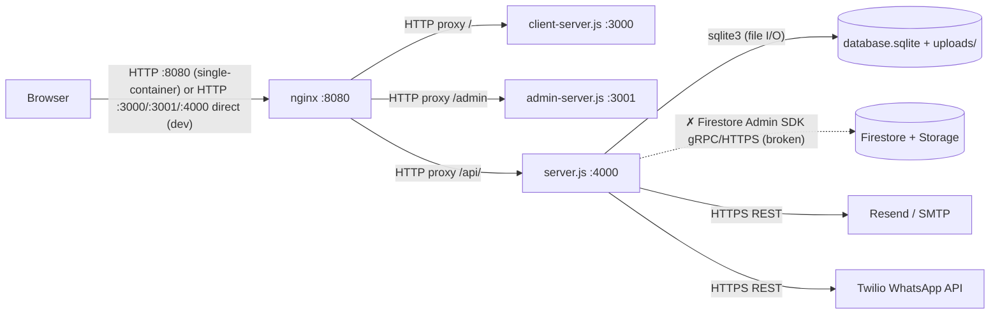
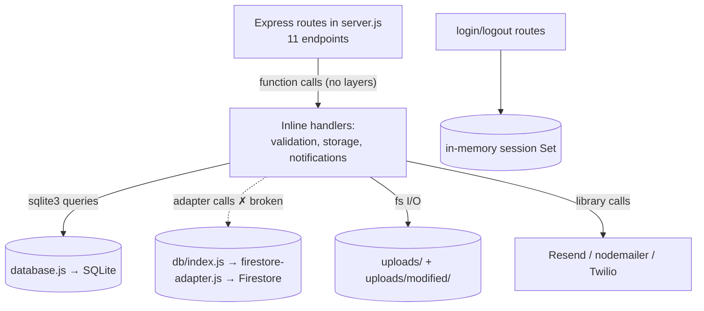
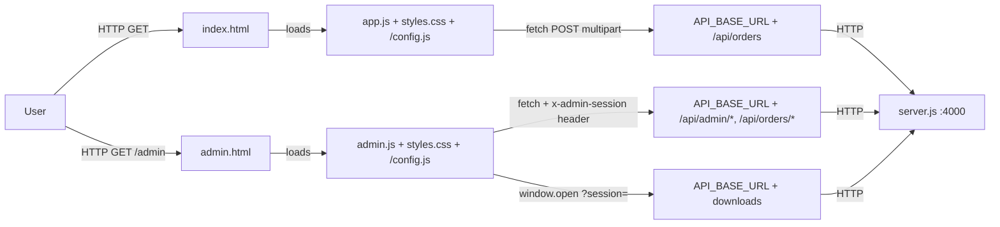
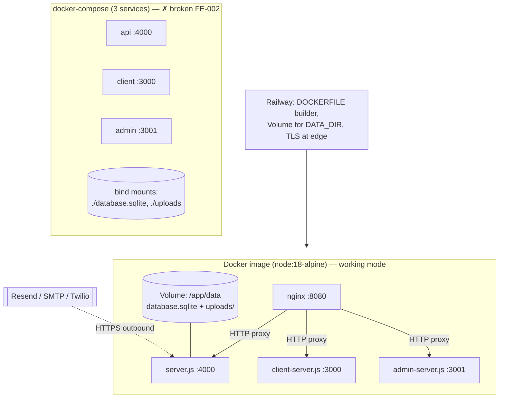

# Project Architecture — ECU Tuning Service

> Verified against code (audit 2026-11-05). All diagrams label protocols. Broken paths marked with ✗.

## (A) General architecture

- Dev mode: browsers hit :3000/:3001/:4000 directly (no nginx).
- Compose mode: no nginx container → `✗` `/api/*` on :3000/:3001 404s (FE-002).
- External calls (email/WhatsApp) originate from the API process only.

## (B) Backend — monolithic reality

Honest notes: there is **no controller/service/repository split** — `server.js` (801 lines) contains routing, business logic, validation, and notifications. The only abstraction is the two DB adapters (`database.js` vs `firestore-adapter.js`), and even that contract is asymmetric (SQLite drops download-URL fields).

## (C) Frontend

- `window.API_BASE_URL` is injected by `/config.js` (client/admin servers). Dev → `http://localhost:4000`; production → `''` (same-origin, needs nginx).

## (D) Infrastructure

Ports & protocols:

| Port | Service | Protocol |
|---|---|---|
| 8080 | nginx (entry) | HTTP |
| 4000 | API `server.js` | HTTP (JSON API) |
| 3000 | client `client-server.js` | HTTP (static) |
| 3001 | admin `admin-server.js` (compose: 3001) | HTTP (static) |
| 5001/8080/9099/9199 | Firebase emulators (functions/firestore/auth/storage) + UI 4005 | HTTP (dev only) |

Volumes: `database.sqlite` (persistent data), `uploads/` (ECU + modified files). ⚠️ Fresh-clone compose: gitignored `database.sqlite` bind mount becomes a directory → crash loop.
