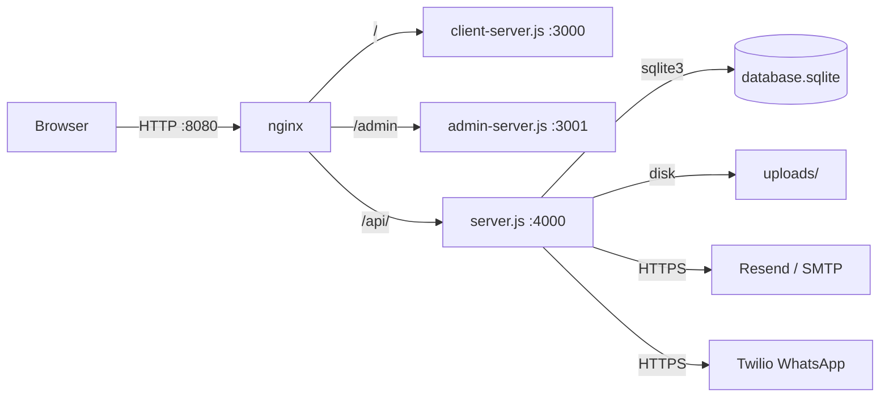

# ECU Tuning Service — Project Overview

> Package: `ecu-tuning-service` v1.0.0 · Generated 2026-11-05 from verified audit evidence (no re-audit).

## What it is

A web platform for **ECU file modification orders**. A customer uploads an ECU binary, picks one of 12 French tuning services, and pays; an admin receives the order, prepares the modified file, and uploads it back; the customer is notified by email (Resend/SMTP) and WhatsApp (Twilio).

## Objective

Let visitors submit ECU tuning orders and let a single admin manage the full order lifecycle — intake → processing → delivery of the modified file — with automatic notifications.

## What it does

| Feature | Details (verified) |
|---|---|
| Order intake | Public form: ECU file upload (`.bin .hex .ori .winols .dam`, max 50 MB) + vehicle info + contact details |
| Service catalog | 12 French services: Stage 1, E85, FAP, EGR, FAPEGR, AdBlue, Utilitaire, ImmoOff, Recherche, Diagnostic, DTCOff, Autres |
| Admin panel | Password login, order list/detail, status filter/search, status updates, upload of modified file, downloads, delete |
| Notifications | Admin email alert on new order; customer email + WhatsApp on modified-file-ready |
| Storage modes | Local SQLite + filesystem (default, working) or Firebase Firestore/Storage (declared, broken — see audit BUG-005/006/007/008/015) |

## Technologies

| Layer | Technology |
|---|---|
| Backend | Node.js + Express 4.21.2 (CommonJS, no build step) |
| Frontend | Vanilla HTML/CSS/JS (no framework, no build) |
| Database | SQLite (`sqlite3` driver, table `orders`); optional Firestore adapter |
| Files | Local `uploads/` directory; optional Firebase Storage |
| Email | Resend (primary) or SMTP via nodemailer |
| WhatsApp | Twilio API (falls back to a `wa.me` link when unconfigured) |
| Reverse proxy | nginx (port 8080, single-container image) |
| Deployment | Docker (single-container), docker-compose (3 services), Railway (Dockerfile builder) |

## General architecture

Three Node processes in one codebase:

- `server.js` (API, port 4000) holds **all business logic** — monolith, no controllers/services/repositories.
- `client-server.js` (:3000) and `admin-server.js` (:3001) serve the static frontend and inject `/config.js` (`window.API_BASE_URL`).
- Auth is a single shared password with in-memory session tokens.

## Current state (honest box)

| Area | Status |
|---|---|
| SQLite + single-container (nginx) mode | ✅ Works — this is the only verified-working deployment path |
| docker-compose mode | ❌ Broken — production `NODE_ENV` forces empty `API_BASE_URL`, compose has no nginx → all `/api/*` calls 404 (FE-002) |
| Firebase mode | ❌ Broken — inconsistent gating (BUG-006), deny-all storage rules (BUG-008), missing email attachments (BUG-005) |
| Tests | ❌ None (no test framework, no CI; only a Windows PowerShell smoke script) |
| Security | ⚠️ Default admin password `admin123`, no rate limiting, stored XSS in admin panel, session tokens in URL |
| Dependencies | ⚠️ 39 npm audit vulnerabilities (2L/13M/19H/5C); container pins Node 18 which blocks most fixes |

**Reference:** detailed findings in `~/.fd-plan/ecu-tuning/technical-audit/findings/` (backend.md, frontend.md, infrastructure.md, dependencies.md, mapper.md).
