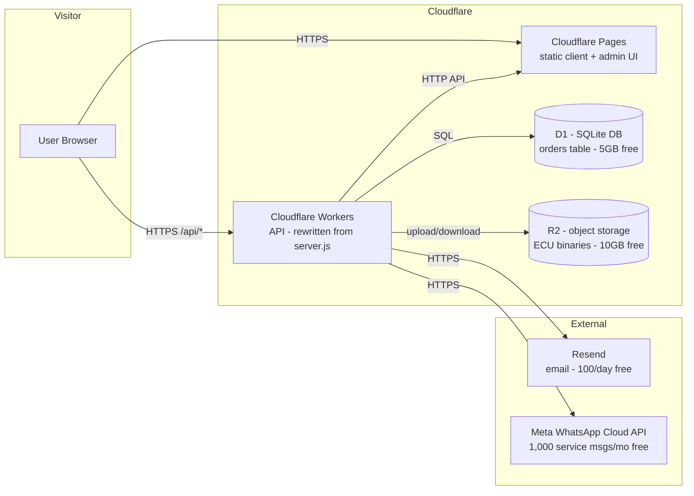
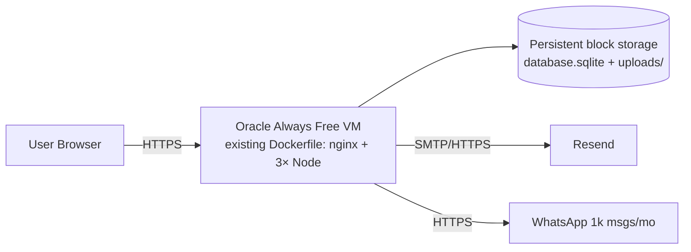

# RECOMMENDED $0 DEPLOYMENT ARCHITECTURE — ECU Tuning Service

**Date:** 2026-11-05 · Verified free-tier data: see `FREE_HOSTING_ANALYSIS.md`. Laptop is NOT part of production. Nothing has been deployed; this document is the plan awaiting your approval.

---

## 1. Primary architecture (matches your target: Cloudflare Pages → Workers → hosted DB)

### Component-by-component

| Service | Hosts | Connects to | Why chosen | Configuration required | Limitations | Genuinely $0? |
|---|---|---|---|---|---|---|
| **Cloudflare Pages** | `public/index.html` (client) and `public/admin.html` (admin) as two static sites (or one site with `/admin` path) | Workers via `/api/*` | Unlimited bandwidth, no egress fees, no card, git-integrated deploys | `API_BASE_URL` = `https://<worker>.workers.dev` (or custom domain); no `/config.js` needed anymore — bake the URL at build | Static only | ✅ Yes |
| **Cloudflare Workers** | The API (re-implemented from `server.js`): 11 routes, auth, validation | D1 (orders), R2 (files), Resend, WhatsApp | 100k req/day free, no sleep, no card, same vendor as Pages → zero egress between them | Port Express code to Workers (Hono or plain fetch); sessions as signed cookies; password in Workers Secret; CORS allowlist | V8 isolate: no `sqlite3` native module, no local disk, 30s CPU | ✅ Yes (requires refactor) |
| **Cloudflare D1** | `orders` table (SQLite dialect — least SQL change vs Postgres) | Workers | 5GB + 5M row reads/day free; SQLite dialect keeps the existing schema nearly verbatim | Recreate schema in D1 (incl. `ecu_reference` column as a real migration, not runtime ALTER); parameterized SQL already compatible | Row-read/day quota; no native full-text search (not needed) | ✅ Yes |
| **Cloudflare R2** | ECU uploads (originals + modified files) | Workers | 10GB free, zero egress; fits the 50MB binary workflow | Upload via presigned URL or direct `PutObject`; filenames server-generated (fixes the traversal bug from the audit) | 10GB total storage | ✅ Yes |
| **Resend** | Transactional email | Workers | 100/day free, HTTP API (no SMTP port blocks) | `RESEND_API_KEY` as Workers Secret | 100 emails/day | ✅ Yes |
| **Meta WhatsApp Cloud API** | WhatsApp notifications | Workers | Only free path that exists | Phone-number verification, business account setup | 1,000 service msgs/mo free, then paid | ⚠️ Partially (paid beyond 1k msgs) |

### Required refactor (before this architecture can deploy)
1. **API:** rewrite `server.js` logic into Workers code (routes/auth/validation are portable; adapters change).
2. **Database:** `sqlite3` driver → D1 binding (same SQL dialect; drop runtime `ALTER TABLE` for a real migration).
3. **Uploads:** multer disk writes → R2 (presigned URL flow: browser uploads directly to R2, worker records metadata). **This also removes the FE-005 500-HTML bug and the filename-traversal risk.**
4. **Frontend:** fix `API_BASE_URL` resolution (hardcode the Worker URL / custom domain at deploy time); the FE-002 compose bug disappears because there is no compose topology anymore.
5. **Admin auth:** keep password auth but fail-closed (no default), rate-limit via Workers rate limiting, signed-cookie sessions (fixes SEC-002/003).
6. **Notifications:** send via `ctx.waitUntil()` (the idiomatic replacement for the fire-and-forget pattern) with at-least-once retry.
7. Drop dead infra: `functions/`, `dataconnect/`, `db/firestore-adapter.js` (unless Firestore stays for something real), `firebase-admin-init.js`.

### Limitations to accept
- Refactor effort (a few days of work for an engineer).
- Workers 100k requests/day and D1 5M reads/day are generous for this traffic profile but are hard ceilings.
- WhatsApp beyond 1,000 msgs/mo costs money — make it optional or accept the charge.

---

## 2. Alternative architecture (minimal code change, still $0 long-term)

If you refuse to refactor Express, the only realistic $0 option that runs the existing Dockerfile **unchanged**:

| Service | Why | Limitation |
|---|---|---|
| **Oracle Cloud Always Free** | 2 AMD Micro + Ampere A1 (4 OCPU/24GB) VMs, 200GB persistent storage, real VMs → native `sqlite3`, multer disk, nginx all work as-is | **Credit card required at signup for identity verification (no charges)**; idle-VM suspension after ~30 days of no traffic (a free uptime-pinger avoids it); single-region |
| **Render free web service** (distant second) | No card | Spin-down after 15 min idle **wipes uploads + DB** (ephemeral FS) and **blocks SMTP** — not "unchanged" in practice; not recommended for this app |

Alternative DB upgrade path for this option: swap SQLite for **Turso** (libSQL, free 5GB, no card) so the DB survives container restarts; keep files on the VM's persistent volume or move to R2.

---

## 3. Comparison

| Criterion | Primary (Pages + Workers + D1 + R2) | Alternative (Oracle VM, unchanged code) |
|---|---|---|
| Monthly cost | $0, no card | $0, card at signup only |
| Laptop needed | No | No |
| Sleep/idle behavior | None | VM idle-suspension risk (mitigable) |
| Code changes | Moderate refactor (DB driver, uploads, API port) | None (Dockerfile runs as-is) |
| Scalability | Auto (Cloudflare edge) | Fixed VM size |
| Email/WhatsApp | Resend + Meta free tiers | Same |
| Vendor lock-in | Cloudflare | Oracle |
| My recommendation | ✅ **Primary** — matches your target, no card, no sleep, and fixes most audit findings (upload path, sessions, DB migrations) | Fallback if refactoring is not acceptable |

## 4. Before starting deployment, prepare

1. **Decide** primary vs alternative (this document = approval point).
2. Create free accounts: Cloudflare (no card), Resend (no card); Meta Business only if WhatsApp is kept.
3. Export from the current laptop: `database.sqlite` (2 test orders) + `uploads/` → seed D1/R2 after setup.
4. Collect the env vars as secrets (names only, values in Workers Secrets): `ADMIN_PASSWORD` (choose strong), `RESEND_API_KEY`, `TWILIO_ACCOUNT_SID`, `TWILIO_AUTH_TOKEN`, `TWILIO_WHATSAPP_NUMBER`, `ALLOWED_ORIGINS`.
5. Choose domain: free `*.pages.dev` / `*.workers.dev` subdomains, or point your own domain (Cloudflare DNS free).
6. Free CI/CD: connect the GitHub repo to Cloudflare Pages + `wrangler deploy` from GitHub Actions.
7. Free monitoring: Cloudflare Analytics + a free uptime checker.

**Nothing has been deployed. Awaiting your approval before any execution.**
